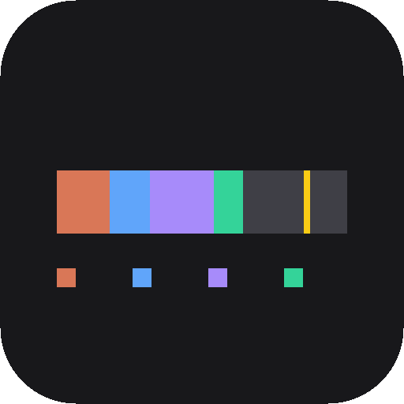
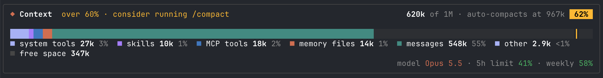
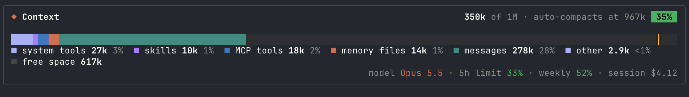
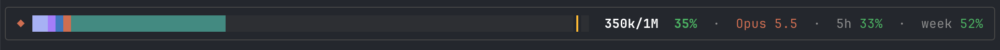
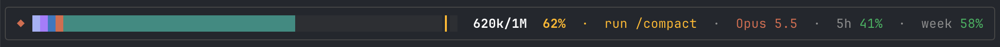
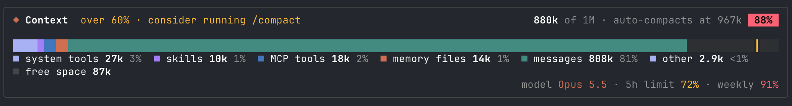
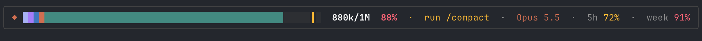

# Syaq

Syaq (سياق, Arabic for context) is a context mod for Claude Code.

Claude Code's context fills up quietly in the background. You only find out when auto-compaction interrupts you, at the worst moment.

Syaq puts it in view: how full the context is, what's filling it, where auto-compact will kick in, plus your usage limits and the current model.

When you hit a threshold you set (60% by default), it nudges you to run `/compact`, while it's still cheap, instead of at the last second.



## Install

At the prompt of a Claude Code terminal session:

```
/plugin install syaq --marketplace hassanhafezzz/syaq
```

Answer `y` to add the marketplace, then pick a scope (user scope loads it in every session). Its command is `/syaq`.

From a shell:

```
claude plugin install syaq --marketplace hassanhafezzz/syaq
```

In the desktop app, where `/plugin` does not run: click **+** next to the prompt box, then **Plugins**, **Add marketplace** with `hassanhafezzz/syaq`, then **Add plugin**.

It needs Claude Code 2.1.310 or later.

### Updating

Claude Code doesn't update plugins from your own marketplaces on its own. To get new versions as they're released, turn on auto-update once: run `/plugin`, open **Marketplaces**, pick **syaq**, then **Enable auto-update**. Run `/reload-plugins` when it tells you an update is in.

Or update by hand from a shell (`syaq@syaq` is the plugin `syaq` from the marketplace `syaq`):

```
claude plugin update syaq@syaq
```

### Uninstalling

```
claude plugin uninstall syaq@syaq
```

## What it looks like

There are two views: a full (detailed) view and a slim (compact) view. and you can switch between them using (`/syaq`). 

Each colour is a category of the context window, sized to its share, and the yellow marker is where auto-compaction starts.

**Mid-session.** Messages take over. On pay-as-you-go plans, the footer adds what the session has cost:




**Past your threshold.** The badge turns yellow and the panel suggests `/compact`; the full view is the one at the top:



**Close to auto-compaction.** The badge turns red from 85%. The rate limits have their own colours: yellow from 60%, red from 85%:




When the context crosses the threshold, the prompt box offers `/compact` (Tab, then Enter, runs it) and a toast says so:

```
🧹 Conversation context is 62% full · run /compact to free up space
```

## Use it

```
/syaq              switch between the full and slim views
/syaq full         the full view: header, bar, legend and footer
/syaq slim         the slim view: one line
/syaq at 70        suggest /compact from 70% instead of 60% (any percent from 1 to 99)
```

Your view is remembered across sessions. The views' earlier names, `detailed` and `simple`, still work.

Syaq answers in the chat:

```
/syaq
syaq: Slim view on

/syaq full
syaq: Full view on

/syaq at 70
syaq: Suggests /compact from 70%

/syaq at 150
syaq: Give a percent from 1 to 99, like /syaq at 70.

/syaq tiny
syaq: Unknown view "tiny". Use /syaq, /syaq full, /syaq slim or /syaq at <percent>.
```

### The panel

| You see | It means |
| --- | --- |
| Coloured runs on the bar | one per category of the context window (system prompt, tools, memory files, skills, messages and so on), sized to its share. Past the five largest, the rest share one "other" run. The filled part always matches the percentage. Deferred tools sit outside the window, so they're left out |
| The yellow marker | where auto-compaction starts, when it's turned on |
| `■ skills 10k 1%` | a legend entry: the category's tokens and its share of the window |
| `■ free space 617k` | the room left before auto-compaction starts, not before the window is full |
| The badge, `35%` | how full the context is: green, yellow from your threshold, red from 85% |
| `over 60% · consider running /compact` | you're past the threshold: a good moment to compact. Shorter on narrower terminals |
| The footer | the model, rate-limit usage (5-hour, weekly, spend) and, on pay-as-you-go plans, what the session has cost so far. The limit figures turn yellow at 60% and red at 85% |

The full view fits the terminal's width, dropping what's there for reference before what you act on:

| Width | What changes |
| --- | --- |
| 100 columns and up | Everything shows |
| 70 to 99 | No auto-compact point in the header (the marker shows it), a shorter `/compact` hint, the three largest categories in the legend and no free space, short footer labels |
| 50 to 69 | Header, bar and limits only: no legend, model or cost |
| Under 50 | The slim layout, whatever view you chose; widen the terminal and your view comes back |

On a narrow terminal the slim view drops the rate limits, then the model, to keep the bar readable.

The panel shows in the terminal. Elsewhere, you'll still get the toast and the `/compact` suggestion.

### The /compact nudge

The prompt box offers `/compact` once each time the context crosses the threshold, as soon as the box is empty and no turn is running. The toast shows once per crossing too. After a compaction brings the context back under, the nudge comes back the next time the context fills up.

### Settings

The threshold is 60% by default. Change it with `/syaq at <percent>`, or open `/config` and set **Suggest /compact at (%)** under syaq. Both change the same setting, so it's remembered across sessions. The context badge, the hint, the prompt suggestion and the toast all follow it. The rate-limit figures keep turning yellow at 60%.

## How it works

Syaq is a Claude Code hooks module with six hooks:

- **`session.start`** registers the `/syaq` command, restores your view and measures the context.
- **`command.run`**, for `/syaq` only, answers the command. Syaq sees no other command.
- **`session.measure`** refreshes the panel when the context moves. When only the rate limits or cost moved, just those figures update.
- **`session.compact`** measures again after each compaction.
- **`prompt.suggest`**, for Claude Code's own suggestions only, puts `/compact` in their place while the nudge is pending.
- **`ui.render`**, on the band above the prompt, draws the panel and passes the band on, so whatever else draws there stacks underneath.

Beyond those it uses Claude Code's usage figures for the session, its store for your view, its settings for the threshold, and its toasts.

## Your data

Everything stays on your machine. Your view is kept in Syaq's own store under your Claude Code configuration folder, and the threshold in your Claude Code settings. Syaq reads no files, runs no programs, makes no network calls, and reads no credentials.

## Develop

Run a session with the mod loaded straight from a checkout. Saving a file reloads it:

```
claude --plugin-dir .
```

Check it, type-check it and run the tests:

```
claude plugin validate .
npx -p typescript tsc -p .
claude plugin test .
```

The type-check needs `.claude-plugin/types/`, which Claude Code writes the first time it loads the mod.

| Path | What it holds |
| --- | --- |
| `.claude-plugin/plugin.json` | The manifest, including the **Suggest /compact at (%)** setting |
| `.claude-plugin/marketplace.json` | The marketplace that serves the mod |
| `hooks/hooks.json` | Points Claude Code at the hooks module |
| `hooks/register.tsx` | The hooks module: measures usage and draws the panel |
| `types/index.d.ts` | The mod's state contract |
| `tests/band.test.tsx` | Tests run by `claude plugin test` |

Issues and pull requests are welcome. Before opening one, make sure all three checks pass, and add a test for any change in what the panel shows.

## License

[MIT](LICENSE)
