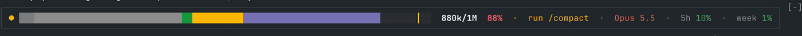
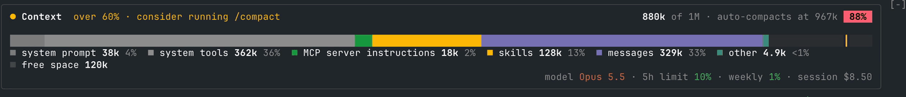

# Syaq

Syaq (سياق, Arabic for context) is a context mod for Claude Code.

Claude Code's context fills up quietly in the background. You only find out when auto-compaction interrupts you, at the worst moment.

Syaq puts it in view: how full the context is, what's filling it, where auto-compact will kick in, plus your usage limits and the current model.

When you hit a threshold you set (60% by default), it nudges you to run `/compact`, while it's still cheap, instead of at the last second.



## Install

At the prompt of a Claude Code terminal session:

```
/plugin install syaq --marketplace hassanhafezzz/syaq
```

Answer `y` to add the marketplace, then pick a scope (user scope loads it in every session). Its command is `/syaq`.

From a shell:

```
claude plugin install syaq --marketplace hassanhafezzz/syaq
```

In the desktop app, where `/plugin` does not run: click **+** next to the prompt box, then **Plugins**, **Add marketplace** with `hassanhafezzz/syaq`, then **Add plugin**.

It needs Claude Code 2.1.310 or later.

### Updating

Claude Code doesn't update plugins from your own marketplaces on its own. To get new versions as they're released, turn on auto-update once: run `/plugin`, open **Marketplaces**, pick **syaq**, then **Enable auto-update**. Run `/reload-plugins` when it tells you an update is in.

Or update by hand from a shell (`syaq@syaq` is the plugin `syaq` from the marketplace `syaq`):

```
claude plugin update syaq@syaq
```

### Uninstalling

```
claude plugin uninstall syaq@syaq
```

## What it looks like

Syaq starts in the **slim view**: one line with the bar, the fill, the model and your limits. When you want the breakdown, `/syaq full` switches to the **full view**, which adds a legend of what's filling the context, where auto-compaction starts, and the session's cost. Run `/syaq` again to go back.

Each colour on the bar is a category of the context window, sized to its share, and the yellow marker is where auto-compaction starts.

**Mid-session.** Messages take over:


The full view names each category. On pay-as-you-go plans it also shows what the session has cost:


**Past your threshold.** The badge turns yellow and the panel suggests `/compact`:


**Close to auto-compaction.** The badge turns red from 85%. The rate limits have their own colours: yellow from 60%, red from 85%:


**After `/compact`.** The freed space flashes green and drains away, and the panel says how much was freed:




When the context crosses the threshold, the prompt box offers `/compact` (Tab, then Enter, runs it) and a toast says so:

```
🧹 Conversation context is 62% full · run /compact to free up space
```

## Use it

```
/syaq              switch between the slim and full views
/syaq slim         the slim view (default): one line
/syaq full         the full view: adds the legend, auto-compact point and session cost
/syaq at 70        suggest /compact from 70% instead of 60% (any percent from 1 to 99)
```

Your view is remembered across sessions. The views' earlier names, `simple` and `detailed`, still work.

Syaq answers in the chat:

```
/syaq
syaq: Full view on

/syaq slim
syaq: Slim view on

/syaq at 70
syaq: Suggests /compact from 70%

/syaq at 150
syaq: Give a percent from 1 to 99, like /syaq at 70.

/syaq tiny
syaq: Unknown view "tiny". Use /syaq, /syaq full, /syaq slim or /syaq at <percent>.
```

### The panel

The legend entries and free space show only in the full view.

| You see | It means |
| --- | --- |
| Coloured runs on the bar | context categories (system prompt, tools, skills, messages…), sized by share; the top five, then "other" |
| The yellow marker | where auto-compaction starts |
| `■ skills 10k 1%` | a category's tokens and share |
| `■ free space 617k` | room left before auto-compaction |
| The badge, `35%` | context used: green, yellow past your threshold, red from 85% |
| `over 60% · consider running /compact` | a good moment to compact |
| `●` animates | the context just grew |
| `−[N] freed` | a compaction just freed that much |
| The footer | model, rate limits and session cost (yellow at 60%, red at 85%) |

The full view adapts to narrow terminals: under 100 columns the legend and labels shorten, under 70 only the header, bar and limits remain, and under 50 it falls back to the slim view.

The panel is terminal-only; elsewhere you still get the toast and the `/compact` suggestion.

### The /compact nudge

The prompt box offers `/compact` once each time the context crosses the threshold, as soon as the box is empty and no turn is running. The toast shows once per crossing too. After a compaction brings the context back under, the nudge comes back the next time the context fills up.

### Settings

The threshold is 60% by default. Change it with `/syaq at <percent>`, or open `/config` and set **Suggest /compact at (%)** under syaq. Both change the same setting, so it's remembered across sessions. The context badge, the hint, the prompt suggestion and the toast all follow it. The rate-limit figures keep turning yellow at 60%.

## How it works

Syaq is a Claude Code hooks module with eight hooks:

- **`session.start`** registers the `/syaq` command, restores your view and measures the context.
- **`command.run`**, for `/syaq` only, answers the command. Syaq sees no other command.
- **`session.measure`** refreshes the panel when the context moves. When only the rate limits or cost moved, just those figures update.
- **`session.compact`** shows what each compaction freed, then measures again.
- **`turn.start`** and **`turn.complete`**, for your own turns only, keep the panel still while the spinner runs; a change during the turn plays once it ends.
- **`prompt.suggest`**, for Claude Code's own suggestions only, puts `/compact` in their place while the nudge is pending. It never changes a suggestion another plugin makes, and it leaves Claude Code's own alone while no nudge is pending.
- **`ui.render`**, on the band above the prompt, draws the panel and passes the band on, so whatever else draws there stacks underneath.

Beyond those it uses Claude Code's usage figures for the session, its store for your view, its settings for the threshold, and its toasts.

### What it sets

Syaq changes one setting: its own **Suggest /compact at (%)** (`syaq.compactAt`, a number from 1 to 99), and only when you run `/syaq at <percent>`. It sets no environment variables and no other configuration.

## Your data

Everything stays on your machine. Your view is kept in Syaq's own store under your Claude Code configuration folder, and the threshold in your Claude Code settings. Syaq reads no files, runs no programs and makes no network calls.

The rate-limit figures in the footer come from Claude Code's own usage figures for the session, which Claude Code gets with your login. Syaq only displays them: it never sees your credentials, and it sends none of these figures anywhere.

## Develop

Run a session with the mod loaded straight from a checkout. Saving a file reloads it:

```
claude --plugin-dir .
```

Check it, type-check it and run the tests:

```
claude plugin validate .
npx -p typescript tsc -p .
claude plugin test .
```

The type-check needs `.claude-plugin/types/`, which Claude Code writes the first time it loads the mod.

| Path | What it holds |
| --- | --- |
| `.claude-plugin/plugin.json` | The manifest, including the **Suggest /compact at (%)** setting |
| `.claude-plugin/marketplace.json` | The marketplace that serves the mod |
| `hooks/hooks.json` | Points Claude Code at the hooks module |
| `hooks/register.tsx` | The hooks module: measures usage and draws the panel |
| `types/index.d.ts` | The mod's state contract |
| `tests/band.test.tsx` | Tests run by `claude plugin test` |

Issues and pull requests are welcome. Before opening one, make sure all three checks pass, and add a test for any change in what the panel shows.

## License

[MIT](LICENSE)
